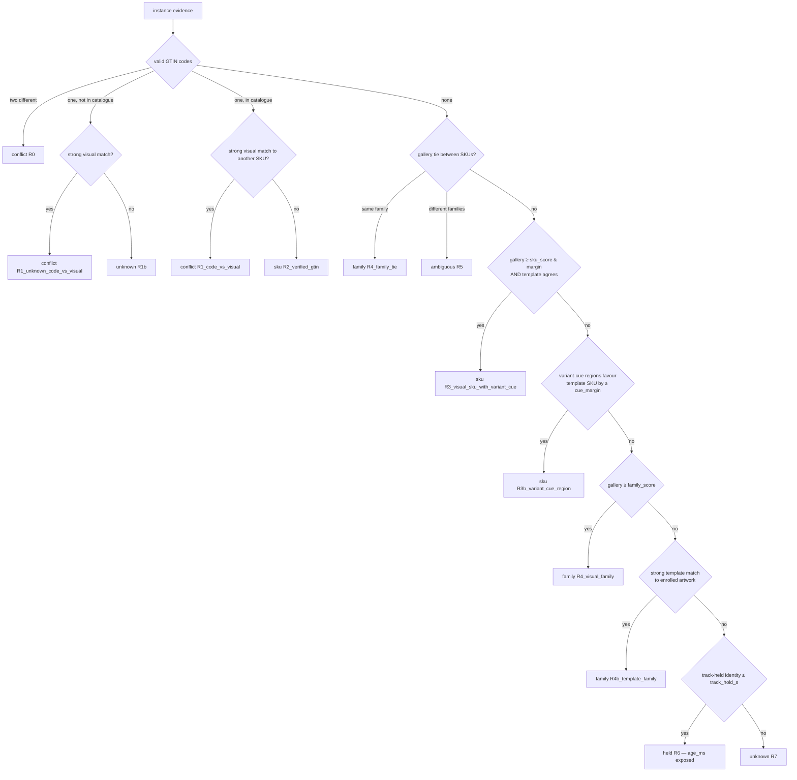

# Architecture

Derived from *Product Recognition & Orientation — Architecture Decision Record 01* (11 pp., 21 Nov 2026).
Page references (p.N) point to that design. Module names below are the actual entry points in `src/pvs/`.

## Runtime path (p.2)

```mermaid
flowchart TD
    subgraph intake["capture.py — Frame (camera, epoch, frame_id, captured_at, transforms)"]
      F1[frame_from_file<br/>EXIF applied once] --> Q
      F2[replay — source order,<br/>original media timestamps] --> Q
      F3[LiveCamera — bounded latest-frame queue,<br/>stale discard, reconnect = new epoch] --> Q
    end
    Q[Pipeline.process — pipeline.py] --> QA{frame quality<br/>dark?}
    QA -- dark --> PQ[status poor_quality]
    QA -- ok --> D[Detector<br/>scripted · Grounding DINO · RT-DETR ONNX]
    D -- load/runtime error --> MF[status model_failed<br/>never substituted]
    D --> M[Masks<br/>SAM 2 · scripted · GrabCut fallback (labelled)]
    M --> CQ{crop blur / glare}
    CQ -- bad --> PQ
    CQ --> T[Tracker — tracker.py<br/>ByteTrack-style, camera:epoch:n IDs]
    T --> I1[gallery.py<br/>DINOv2 / colour-hist embeddings]
    T --> I2[barcode.py<br/>ZXing-C++, GTIN check digit,<br/>polygon → one instance]
    T --> I3[geometry.py fit_axis<br/>orientation.py SIFT template A/B, face, variant cues]
    I1 & I2 & I3 --> FU[fusion.py — versioned rules fusion-v1.5]
    FU --> R[FrameResult schema 1.0 — schema.py]
    R --> O1[render.py overlay / preview]
    R --> O2[api.py REST · WebSocket · /metrics]
    R --> O3[outbox.py SQLite-WAL state-change events]
```

## Evidence decisions (p.6, `fusion.py`)



Direction is never inferred from a mask eigenvector. An arrow is drawn only when the template homography
passes inlier, spread, reprojection and non-mirror gates *and* agrees with the mask axis within 20°.

## Offline events and recovery (p.7, `outbox.py`)

```mermaid
sequenceDiagram
    participant P as Pipeline
    participant O as Outbox (SQLite WAL)
    participant C as Central consumer
    P->>O: record_transition(camera, epoch, track, state) — one transaction:<br/>compare state, seq+1, insert event_id=H(station|camera|epoch|track|seq)
    loop deliver(): head-of-line order, exponential backoff
      O->>C: send(event)
      C-->>C: dedupe by event_id (DedupConsumer / station_event PK)
      C-->>O: ok → mark delivered
    end
    Note over O,C: crash after remote apply, before local ack → event re-sent,<br/>consumer drops duplicate (tested)
    Note over O: full → prune delivered rows; still full → refuse,<br/>raise high-water alarm, increment data_loss counter
```

## Data-to-release (p.5, p.7)

```mermaid
flowchart LR
    A[capture sessions<br/>pack · clip · session IDs] --> B[training/data.py<br/>connected_groups → assign_split<br/>BEFORE frame extraction]
    B --> C[leakage_check<br/>shared IDs + dHash near-dups]
    C --> D[CVAT COCO-keypoints export<br/>box · A/B · visibility · face · identity]
    D --> E1[pvs train detector-smoke / RT-DETR fine-tune]
    D --> E2[pvs train landmark → export ONNX + parity]
    E1 & E2 --> F[pvs eval on frozen thresholds<br/>sealed split, raw counts, exact CIs]
    F --> G[pvs bundle build + Ed25519 sign]
    G --> H[shadow: scripts/shadow_compare.py on identical replay]
    H --> I[pvs bundle install — atomic symlink swap]
    I -->|reference-pack check fails| J[pvs bundle rollback]
```



## Execution profiles

| Profile | Detector | Masks | Identity embedder | Use |
|---|---|---|---|---|
| `fixture` | scripted from generated ground truth (tagged) | scripted | classical colour histogram | deterministic plumbing tests |
| `pretrained` | Grounding DINO tiny (pinned) | SAM 2.1 tiny | DINOv2-small | real inference before training |
| `station` | configured (RT-DETR ONNX or Grounding DINO) | configured | configured | approved signed bundle |

The profile, every backend id and the bundle id are printed by the CLI, returned in every `FrameResult`
(`profile`, `backend`, `model_bundle`) and drawn on the preview banner. A model that fails to load yields
`status: model_failed` with no instances; fixture detections are never used as a fallback.
