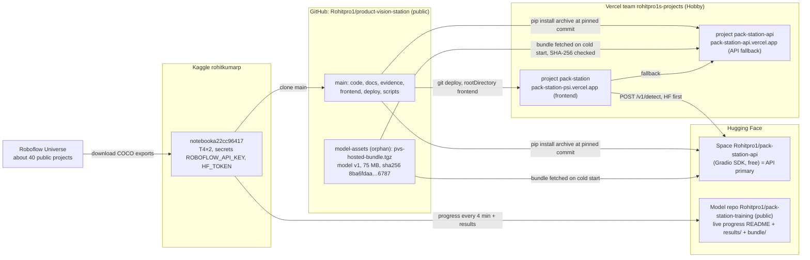
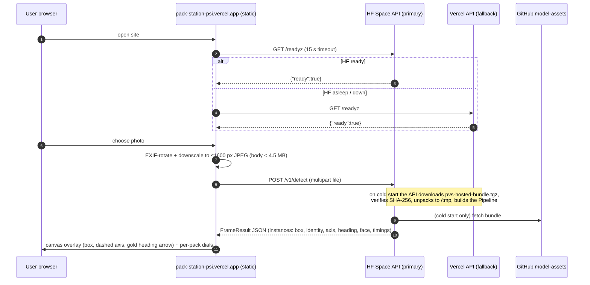
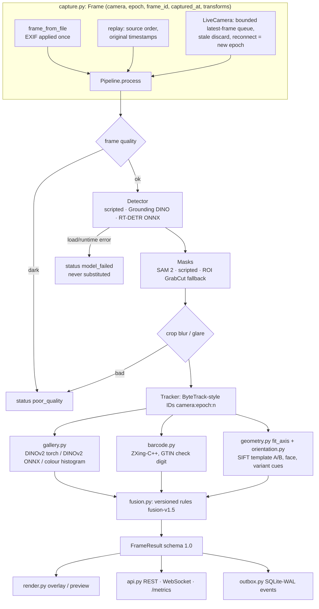
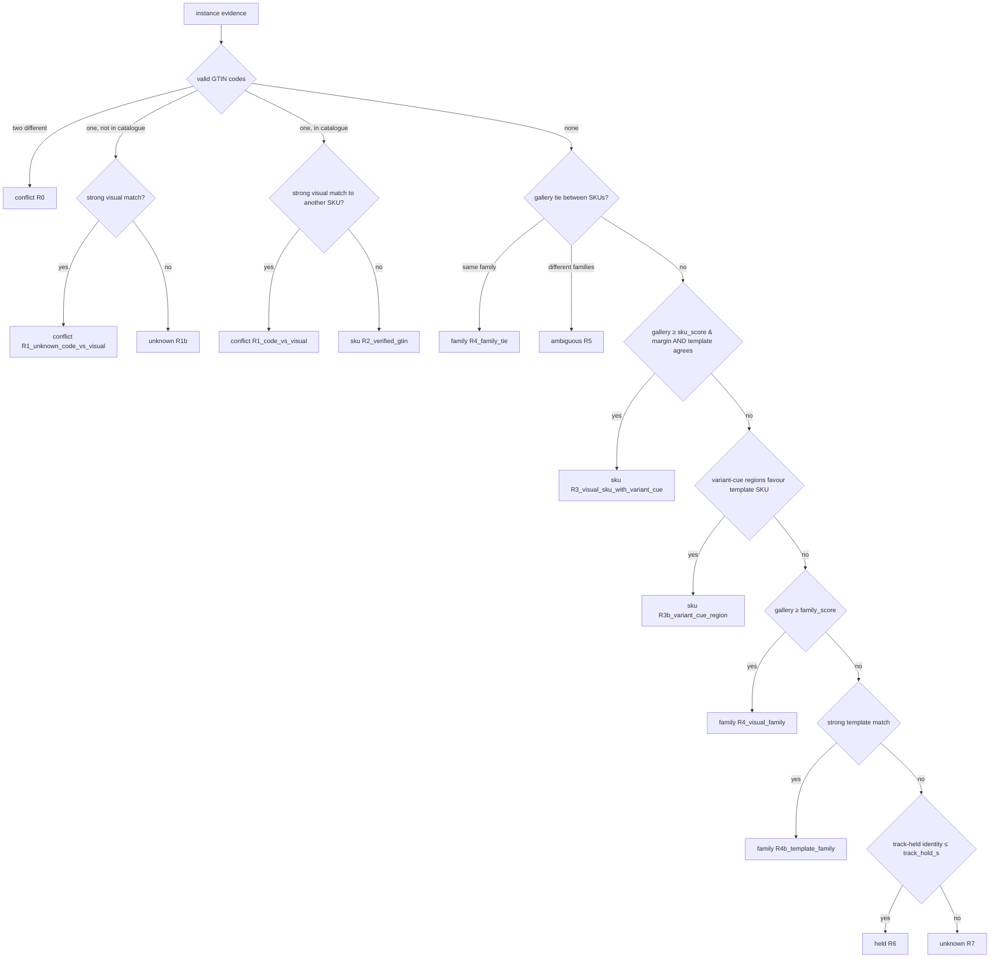
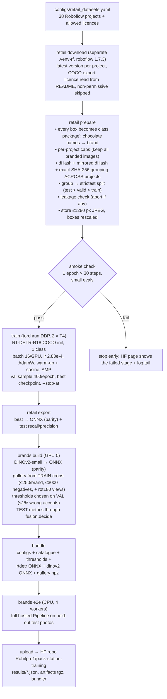
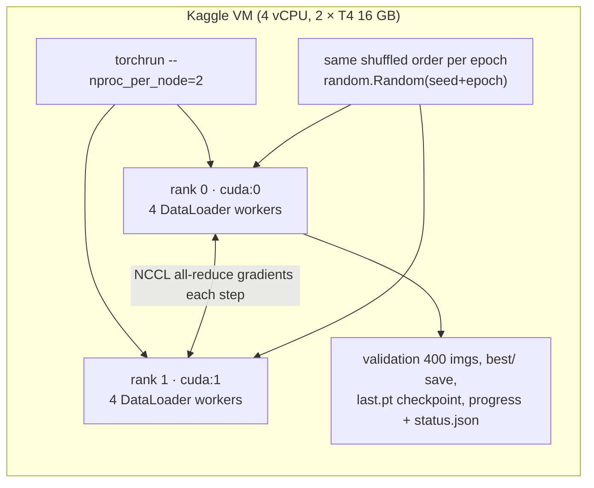
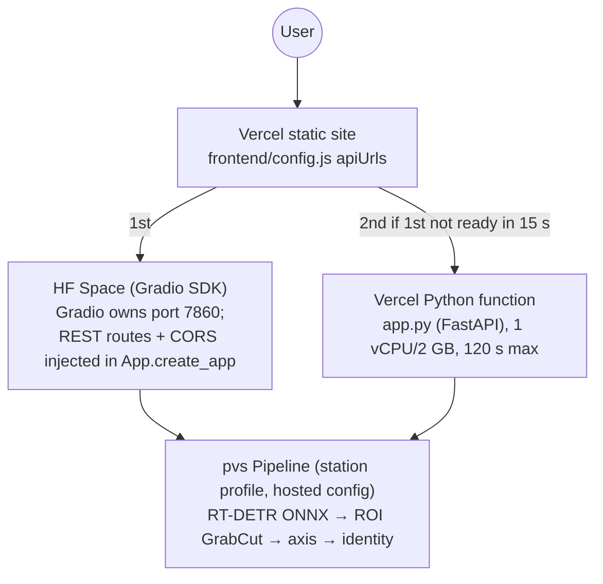
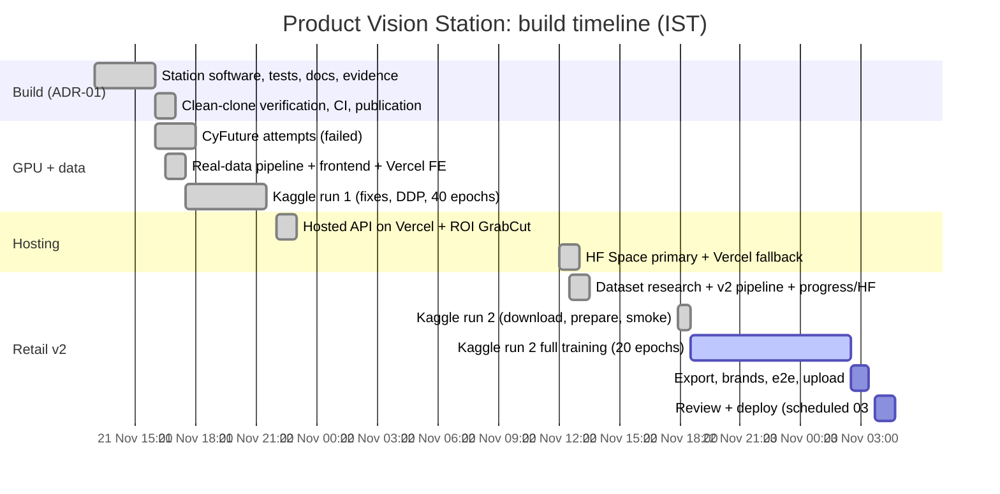

# Product Vision Station — Complete Project Handoff

> **Purpose of this document.** This is the full context for another engineer or AI agent to take over documentation or
> development. It covers everything requested, everything built, what is live, what is training, the datasets used,
> architecture diagrams, scripts, repositories, hosting, decisions, failures and fixes, and open items.
>
> **Snapshot time:** 22 Nov 2026, 20:38 IST (15:08 UTC). Facts below were taken from the repository at commit
> `ed64b5e` plus the live status page at that time. Anything not directly measured is marked *(estimate)* or
> *(derived)*.
>
> **Owner:** Rohit (GitHub `Rohitpro1`, Hugging Face `Rohitpro1`, Kaggle `rohitkumarp`, Vercel team
> `rohitpro1s-projects`).

> **Formal submission:** the checksummed engineering submission pack for 22 Nov 2026 is in
> [`docs/submission/2026-11-22/`](submission/2026-11-22/). It includes the completion report PDF, extracts,
> diagrams, registers and frozen evidence, with v2 telemetry frozen at 22:07 IST (epoch 10 of 20). This handoff
> keeps running context; the pack is the formal record.

---

## Contents

1. [One-paragraph summary](#1-one-paragraph-summary)
2. [What was asked (chronological)](#2-what-was-asked-chronological)
3. [What is live right now (public)](#3-what-is-live-right-now-public)
4. [What is training right now](#4-what-is-training-right-now)
5. [Repositories and where everything lives](#5-repositories-and-where-everything-lives)
6. [System architecture (diagrams)](#6-system-architecture-diagrams)
7. [The recognition pipeline in detail](#7-the-recognition-pipeline-in-detail)
8. [Code map: every module](#8-code-map-every-module)
9. [Scripts explained](#9-scripts-explained)
10. [Training run 1: 5 Star / public retail (finished)](#10-training-run-1-5-star--public-retail-finished)
11. [Training run 2: retail v2 + chocolate brands (in progress)](#11-training-run-2-retail-v2--chocolate-brands-in-progress)
12. [Datasets](#12-datasets)
13. [Hosting and deployment](#13-hosting-and-deployment)
14. [Frontend (website)](#14-frontend-website)
15. [Verification and test evidence](#15-verification-and-test-evidence)
16. [Decision log (summary)](#16-decision-log-summary)
17. [Problems hit and how they were fixed](#17-problems-hit-and-how-they-were-fixed)
18. [Security, licensing and data-handling rules](#18-security-licensing-and-data-handling-rules)
19. [Open items, risks and next steps](#19-open-items-risks-and-next-steps)
20. [Timeline](#20-timeline)
21. [Glossary](#21-glossary)

---

## 1. One-paragraph summary

**Product Vision Station** recognises wrapped retail packs in an image or video stream, initially Cadbury 5 Star. For every
pack it reports its own bounding box, an identity at the strongest level the evidence supports (`sku` › `family` ›
`unknown`, or `conflict` / `ambiguous`), an undirected long **axis** angle [0°, 180°), a directed **heading** A→B
[0°, 360°) when the pack's ends are identifiable, and the visible **face**. The full station software was built from an
11-page architecture decision record (ADR-01), and covers capture, a tracker, evidence fusion rules, a REST/WebSocket API,
an offline-safe outbox, signed model bundles, evaluation with exact confidence intervals, and training/export tooling.

On top of the station software:

- A generic pack detector (RT-DETR-R18) was trained on public retail data on Kaggle's free 2 × T4 GPUs. Its held-out
  test recall is 0.964 and precision 0.967.
- That detector is **live** behind two free backends: a Hugging Face Space (primary) and Vercel (fallback). A public
  website at https://pack-station-psi.vercel.app uploads photos to them.
- A second, much larger training run is in progress on Kaggle. It uses about 40 public Indian retail and chocolate
  datasets to improve detection of any packaged product and to add chocolate brand naming (5 Star, Dairy Milk,
  KitKat, Munch, Perk, …).
- **Real 5 Star recognition is still not validated**: public data gave 0/3 test hits. That needs real photographs
  of physical packs.

---

## 2. What was asked (chronological)

| # | Request (paraphrased) | Outcome |
|---|---|---|
| 1 | Execute `Product_Vision_Build_Agent_Prompt.md` using `Product_Recognition_and_Orientation_Architecture.pdf` (ADR-01) as the spec. Build, verify, create and push a GitHub repo; return the repo URL, commit SHA, test evidence and real 5 Star validation status. | Done. Repo `Rohitpro1/product-vision-station` (created by Rohit, **public**). Station software, tests, docs and evidence. Real 5 Star: **not validated** (no real data). |
| 2 | "Continue if any failed and finalise", "check I have created the repo" | Fixes, clean-clone verification, CI, publication recorded. |
| 3 | Use the GPU site open in Chrome (CyFuture), credits topped up; train on public 5 Star datasets; deploy the frontend on Vercel and the backend on Render; connect them. Budget **≤ ~$15 (₹1,300)**. | CyFuture failed: VMs stuck or failed, GPUs out of stock. Moved to **Kaggle (free 2 × T4)**. Frontend deployed on **Vercel**. Backend on Render deferred by the user's choice. |
| 4 | Data: Roboflow (logged in), user pasted Roboflow code; two COCO exports attached (SCt v6, Scancart v2). | Real-data pipeline `pvs.training.real5star` built. Kaggle run 1 trained the detector and the 5 Star gallery. |
| 5 | "Use both GPUs, faster"; `wrapt` errors on Kaggle | DDP training via `torchrun`; clean-environment runner (Kaggle `sitecustomize` isolation). |
| 6 | Training done → "proceed further" | Results recorded as evidence; docs updated. |
| 7 | "Host the backend anywhere free and connect it to the frontend" | Torch-free hosted profile on **Vercel Python** (`pack-station-api`); frontend wired; model bundle served from the GitHub `model-assets` branch. |
| 8 | "Host the trained model live, Kaggle / Hugging Face / any" | **Hugging Face Space** `Rohitpro1/pack-station-api` (Gradio SDK, free tier) as **primary**, Vercel as automatic fallback. |
| 9 | "It says unknown for 5 Star, why?" | Explained: the detector is trained, but identity has no real 5 Star references. |
| 10 | "Improve training with public datasets; detect any retail / Indian product; categorise chocolates; use any site" | **Retail v2 pipeline**: about 40 Roboflow projects, licence-filtered; multi-dataset detector; DINOv2 brand gallery; end-to-end evaluation. |
| 11 | "Show live progress + ETA, push results somewhere automatically" | Progress lines with ETA (IST), a live Hugging Face progress page, auto-upload of results to `Rohitpro1/pack-station-training`. |
| 12 | Kaggle errors (`requests` missing); queued-run questions | `roboflow` moved into its own venv. Run 2 started 17:55 IST and is in progress. |
| 13 | Make the progress page public for the team | Rohit made the HF repo public (verified: `private: false`). |
| 14 | This document | You are reading it. |

---

## 3. What is live right now (public)

| What | URL | Notes |
|---|---|---|
| **Website** | https://pack-station-psi.vercel.app | Static site on Vercel (project `pack-station`). Upload a photo and see boxes, axis lines and identity. |
| **API, primary** | https://rohitpro1-pack-station-api.hf.space | HF Space `Rohitpro1/pack-station-api` (Gradio 6.32 SDK, free ZeroGPU tier, CPU inference). It also serves an upload page at `/`. |
| **API, fallback** | https://pack-station-api.vercel.app | Vercel Python function (project `pack-station-api`). |
| **Training progress + results** | https://huggingface.co/Rohitpro1/pack-station-training | Public model repo. The README is a live progress page refreshed every 4 min; results are uploaded at the end. |
| **Source** | https://github.com/Rohitpro1/product-vision-station | Public repo, branch `main`. Model bundle v1 is on the orphan branch `model-assets`. |

**What the live model does today (v1):** it finds packs with the trained RT-DETR-R18 detector. Training data was
public Indian retail photos, with a test recall of 0.964. The live model measures each pack's axis with GrabCut plus
a PCA axis fit. It returns identity `unknown` for real products, because the demo catalogue on the server is
synthetic. That is correct behaviour, not a bug.

**Live API endpoints (both hosts):**

- `GET /readyz` returns `{"ready":true,"profile":"station","bundle":"hosted-onnx-demo"}`.
- `GET /healthz`.
- `POST /v1/detect` takes multipart `file` and returns a `FrameResult` JSON. The schema version is 1.0; see
  `docs/API.md` and `GET /v1/schema`.
- CORS allows only `https://pack-station-psi.vercel.app`. No API token is required; the endpoints are read-only and
  store nothing.

**Measured live latency:**

| Host | Warm request | Cold start |
|---|---|---|
| HF Space | about 3.3 s per request | the Space sleeps after about 48 h idle; waking takes minutes |
| Vercel | about 2.3 s per request | about 20 s after 5 min idle |

---

## 4. What is training right now

**Kaggle notebook** `rohitkumarp/notebooka22cc96417`, saved version (commit run), **GPU T4 × 2**, started
**17:55 IST (12:25 UTC)**.

**Status at 20:38 IST, from the live page:**

```
[train] 9,695/35,080 steps (27.6%) | 1.21 steps/s | stage ETA 5h48m (02:24 IST) | run ETA 6h37m (03:13 IST)
| epoch 6/20 | loss 7.561 | imgs_per_s 38.8
```

| Stage | Took | Status |
|---|---|---|
| setup | 13 s | done (both T4s, torch 2.6.0+cu124, Python 3.13.16) |
| download | 6 min | done (Roboflow, licence-filtered) |
| prepare | 18 min | done (merge, dHash de-dup, leakage check, ≤1280 px) |
| smoke check | about 2.5 min total (train 72 s, export 17 s, brands 25 s, bundle 1 s, e2e 40 s) | **passed every stage** |
| full train | about 8.3 h *(estimate)* | in progress: epoch 6 of 20, about 24 min per epoch, both GPUs |
| export / brands / bundle / e2e / upload | about 50 min *(estimate)* | pending |

Expected finish: **about 03:15 IST on 23 Nov**. The Kaggle 12 h cutoff is about 05:55 IST; the training safety stop
(`--stop-at`) is 04:25 IST.

**Validation during training.** Each epoch is checked on a random sample of 400 validation images at IoU 0.5:

| Epoch | Loss | Recall | Precision |
|---|---|---|---|
| 1 | 17.59 | 0.766 | 0.612 |
| 2 | 8.76 | 0.779 | 0.690 |
| 3 | 8.18 | 0.792 | 0.678 |
| 4 | 7.84 | 0.665 | 0.838 |
| 5 | 7.55 | 0.816 | 0.699 |

These are lower than run 1's 0.964, but the two aren't comparable: run 2's validation set is far harder (about
40 sources, dense shelves, many packs per image). The figures that count will be the held-out **test** numbers in
the final reports.

**Size *(derived)*:** 35,080 steps / 20 epochs = 1,754 steps per epoch × global batch 32 ≈ **56k training images**
after caps and de-duplication.

**Follow-up scheduled:** a check at **03:40 IST on 23 Nov** will pull the results from the HF repo, review the test
metrics, and deploy only if they hold up; otherwise it reports. The trigger is `trig_01EPMXx41229jCzJJzunAUKK`.

---

## 5. Repositories and where everything lives



### Repository layout (`main`)

```
src/pvs/                     the Python package (CLI entry point: `pvs`)
  capture.py transforms.py geometry.py detectors/ gallery.py orientation.py barcode.py tracker.py
  fusion.py pipeline.py schema.py render.py api.py outbox.py catalogue.py bundle.py evaluation.py
  fixtures.py cli.py config.py preview.html
  training/  data.py detector.py landmark.py real5star.py retail.py brands.py brand_map.py progress.py hub.py
configs/                     station.fixture/pretrained/onnx/hosted/hosted-brands.yaml, thresholds.yaml,
                             retail_datasets.yaml
catalogues/                  fixture/ (synthetic, redistributable), templates/
models/manifest.json         pinned weights (repo, revision, SHA-256, licence)
frontend/                    static website (index.html, styles.css, app.js, config.js, vercel.json, examples/)
deploy/                      Dockerfile, docker-compose.yml, pvs.service, Caddyfile, trust/,
                             vercel-api/ (app.py, requirements.txt, vercel.json, .python-version)
                             hf-space/ (README.md, app.py, requirements.txt)
scripts/                     bootstrap.sh, fetch_models.py, fetch_real_examples.py, make_examples.py,
                             build_frontend_examples.py, build_hosted_bundle.sh, gpu_train_5star.sh,
                             gpu_train_retail.sh, real_5star_demo.py, shadow_compare.py, migrate.py
migrations/postgres/         central catalogue/release registry schema
evidence/                    committed results (api, eval, examples, real, replay, training/...)
docs/                        ARCHITECTURE, API, OPERATOR_GUIDE, TRAINING_EVALUATION, VERIFICATION,
                             REQUIREMENTS_EVIDENCE, DECISIONS, EXTENSIONS, reference_drawing, HANDOFF (this)
tests/                       12 test modules, 169 passed + 2 skipped at ed64b5e
render.yaml                  Render blueprint (prepared, never deployed)
```

Size: about 7,200 lines of Python, shell and JS in `src/`, `scripts/`, `frontend/` and `deploy/`.

---

## 6. System architecture (diagrams)

### 6.1 Live system: request path



### 6.2 Station runtime pipeline (from ADR-01 p.2; `docs/ARCHITECTURE.md`)



### 6.3 Identity decision rules (`fusion.py`)



The **brand gallery in run 2** uses exactly these rules, with `sku_score = 1.01`, which disables SKU claims. A brand
therefore becomes a `family` only through **R4_visual_family**, when the best gallery match is a brand at or above
`family_score` and its margin over the best different label is at least `tie_margin`. Non-chocolate products are
explicit `negative:` gallery entries, so their best match leads to `unknown`.

### 6.4 Training run 2 (retail v2) end to end



### 6.5 Multi-GPU training layout (DDP)



Each epoch, every rank shuffles the image list with the same seed, then takes its own disjoint slice
(`order[rank::world]`). The global batch of 32 is split 16 + 16. The time-budget stop decision is all-reduced so
that both ranks stop together.

### 6.6 Hosting topology and fallback



---

## 7. The recognition pipeline in detail

### 7.1 Output contract (`schema.py`, FrameResult 1.0)

Per frame: `status` (`ok`, `poor_quality`, `model_failed`, …), `profile`, `backend` ids, `model_bundle`, and
`timing_ms`.

Per instance:

- `bbox_xyxy_px`
- mask source
- `identity`: level `sku`/`family`/`unknown`/`conflict`/`ambiguous`, plus rule id, scores, `score_type` (raw cosine,
  uncalibrated) and reason code
- `pose.axis`: availability, `value_deg` in [0, 180)
- `pose.heading` A→B: available only when the template homography passes the inlier, spread, reprojection and
  non-mirror gates *and* agrees with the mask axis within 20°
- `face`

Each field has its own evidence, availability, reason code and observation age.

### 7.2 Execution profiles

| Profile | Detector | Masks | Identity embedder | Use |
|---|---|---|---|---|
| `fixture` | scripted from ground truth | scripted | colour histogram | deterministic tests |
| `pretrained` | Grounding DINO tiny | SAM 2.1 tiny | DINOv2-small (torch) | real inference before training (about 13–20 s per frame on CPU) |
| `station` (`station.onnx.yaml`) | trained RT-DETR ONNX | ROI GrabCut | DINOv2 (torch) | GPU or large hosts |
| `station` (`station.hosted.yaml`), **live v1** | trained RT-DETR ONNX | ROI GrabCut | colour histogram, synthetic catalogue | torch-free hosting; `max_instances` 3 |
| `station` (`station.hosted-brands.yaml`), **v2 pending** | retail v2 RT-DETR ONNX | ROI GrabCut | **DINOv2-small ONNX** + brand gallery | brand naming; `max_instances` 30 |

### 7.3 Speed work done

- **ROI GrabCut (D20).** The GrabCut fallback runs on a padded region around the box, downscaled to ≤384 px, instead
  of the full frame. Masks went from 3.6–4.4 s to 0.1–0.3 s per pack, and a frame from about 20 s to about 1 s.
  Axes on the real photos stayed within 1° of before.
- **Client-side downscale.** The browser downscales photos to ≤1600 px before upload, because Vercel caps request
  bodies at 4.5 MB.
- **v2 hosted profile.** The full hosted pipeline (RT-DETR ONNX + GrabCut + DINOv2 ONNX + gallery) measured about
  0.8 s per photo on CPU in the local smoke test.

---

## 8. Code map: every module

| Module | What it does |
|---|---|
| `capture.py` | Builds `Frame` objects from files (EXIF applied once), replays (original timestamps) and a live camera (bounded latest-frame queue; a reconnect starts a new epoch). |
| `transforms.py`, `geometry.py` | Coordinate transforms, EXIF and mirror handling; `fit_axis` (mask PCA → axis angle); rectification. |
| `detectors/base.py` | Detector/mask interfaces; `ThresholdMaskFallback` (ROI GrabCut, labelled as a fallback). |
| `detectors/hf_models.py` | Grounding DINO + SAM 2 wrappers (pinned revisions). |
| `detectors/rtdetr.py` | `RTDetrOnnxDetector`: ONNX Runtime, 640 px input, score threshold 0.5. |
| `detectors/scripted.py` | Fixture detector, tagged as scripted. |
| `gallery.py` | `Gallery` (refs, cosine search, best per SKU, margin to the best *different* SKU); embedders: DINOv2 torch, colour histogram, and **`DinoV2OnnxEmbedder`** (new: letterboxed, landscape-canonical preprocessing shared by training and serving: `dino_preprocess`, `dino_pool` = CLS + mean patch, L2-normalised, 768-d). |
| `orientation.py` | SIFT template matching to front/back references → A/B heading, face, variant cues, with gates. |
| `barcode.py` | ZXing-C++ decoding, GTIN check digit, polygon assigned to one instance. |
| `tracker.py` | ByteTrack-style tracker; IDs `camera:epoch:n`; never re-associates after an evidence gap. |
| `fusion.py` | Versioned identity rules (§6.3). |
| `pipeline.py` | Orchestration; backend loading per config (`embedder: dinov2 | dinov2_onnx | colour_hist`); precomputed gallery via `cfg.gallery`. |
| `schema.py` | Pydantic models for FrameResult 1.0. |
| `render.py`, `preview.html` | Overlays and live preview page (now packaged). |
| `api.py` | FastAPI: `/healthz`, `/readyz`, `/v1/detect`, `/v1/schema`, WebSocket live, `/metrics`; CORS from `PVS_CORS_ORIGINS`; optional bearer token `PVS_API_TOKEN`. |
| `outbox.py` | SQLite-WAL outbox: idempotent event IDs, head-of-line ordered delivery, backoff, overflow alarm. |
| `catalogue.py`, `bundle.py` | Catalogue validation, enrolment and rollback; Ed25519-signed model bundles, atomic install and rollback. |
| `evaluation.py` | Matching, Clopper–Pearson intervals, one-sided upper bounds, sealed-set evaluation. |
| `config.py` | Station config (models, limits, thresholds, catalogue, gallery, bundle). |
| `cli.py` | `pvs detect | replay | serve | eval | catalogue … | train … | bundle …`. |
| `training/data.py` | Group-aware splits and leakage check (capture sessions). |
| `training/detector.py`, `training/landmark.py` | Detector smoke fine-tune; landmark/face head training and ONNX export with parity. |
| `training/real5star.py` | Run 1 pipeline: `prepare` (dHash groups), `train` (**DDP**, AMP, warm-up + cosine, `--stop-at`, live progress), `evaluate` (DINOv2 gallery, thresholds on val, test metrics, ONNX export). Its `train` is reused by run 2. |
| `training/retail.py` | Run 2: `download` (Roboflow, licence filter), `prepare` (cross-project dHash + mirrored + exact grouping, caps, ≤1280 px), `export` (ONNX + test metrics in chunks with progress). |
| `training/brand_map.py` | Class name → brand family: 22 brands, with exclusions such as "Kurkure Masala Munch", "Bournvita" and "Choco Pie". |
| `training/brands.py` | `build` (DINOv2 ONNX export + parity, crops, gallery, threshold search on val, test metrics via `fusion.decide`, catalogue + thresholds files) and `e2e` (full Pipeline over test photos, multiprocessing with progress). |
| `training/progress.py` | Progress lines with stage ETA and run ETA in IST; atomic `status.json`; stage events. |
| `training/hub.py` | HF publisher: `init` (private by default; Rohit made it public), `watch` (README progress page every 4 min), `final` (reports + bundle + log tail). |

---

## 9. Scripts explained

| Script | Purpose |
|---|---|
| `scripts/bootstrap.sh` | Creates the venv, installs pinned locks and the editable package, generates fixtures, runs tests. |
| `scripts/fetch_models.py` | Downloads pinned weights (Grounding DINO, SAM 2, DINOv2, RT-DETR) and verifies SHA-256 (`--only` subset). |
| `scripts/fetch_real_examples.py` | Fetches two CC BY-SA real photos (Open Food Facts 5 Star, Wikimedia Milka) with SHA-256 checks; they are not committed. |
| `scripts/make_examples.py`, `scripts/build_frontend_examples.py` | Build the evidence and frontend examples as lossless PNG, because JPEG changed the results. |
| `scripts/real_5star_demo.py`, `scripts/shadow_compare.py`, `scripts/migrate.py` | Real-photo demo, shadow comparison of two bundles on the same replay, Postgres migrations. |
| `scripts/build_hosted_bundle.sh` | Builds the reproducible runtime bundle for the hosted API (ONNX + hosted config + thresholds + catalogue + manifest) with fixed tar metadata; checks the ONNX SHA-256. |
| `scripts/gpu_train_5star.sh` | **Run 1** runner: uv Python 3.13 venv, torch 2.6.0+cu124 (covers P100/V100/T4), lock filtering (sympy), clean environment (`env -i`, so Kaggle `sitecustomize`/`PYTHONPATH` can't interfere), CUDA self-check, prepare → DDP train → evaluate → tarball. |
| `scripts/gpu_train_retail.sh` | **Run 2** runner (one invocation), described in detail below. |

**How `scripts/gpu_train_retail.sh` runs:**

1. **Setup:** apt dependencies and a clean-environment main venv. Roboflow gets **its own venv `.venv-rf`**, because
   of the typer conflict.
2. **Stage bookkeeping:** `ev <stage> start|done` events, and the full log goes to `$OUT/logs/run.log`.
3. **Live progress:** a background HF watcher pushes the README progress page.
4. **Main sequence:** download → prepare → **smoke pipeline** (1 epoch × 30 steps, 50 test images, 600 crops,
   12 + 8 e2e photos) → full pipeline (train, export, brands, bundle, e2e) → tarball.
5. **Time budget:** `STOP_AT = start + TIME_LIMIT_H − 90 min`.
6. **Exit trap:** marks the run finished or failed (with the stage) and uploads results or the log tail even on
   failure.
7. **Knobs:** `EPOCHS` (default 20), `NGPU`, `BATCH_PER_GPU` (16), `WORKERS` (4), `E2E_WORKERS` (4), `SKIP_SMOKE`,
   `HF_REPO` (`pack-station-training`), `TIME_LIMIT_H` (12), `PUSH_EVERY_S` (240).
8. **Required environment:** `ROBOFLOW_API_KEY`. Optional: `HF_TOKEN`.

**Kaggle cell used for run 2.** The secrets come from Kaggle Secrets and are never printed:

```python
import os
from kaggle_secrets import UserSecretsClient
s = UserSecretsClient()
os.environ["ROBOFLOW_API_KEY"] = s.get_secret("ROBOFLOW_API_KEY")
os.environ["HF_TOKEN"] = s.get_secret("HF_TOKEN")
!rm -rf /tmp/product-vision-station && git clone -q --depth 1 https://github.com/Rohitpro1/product-vision-station /tmp/product-vision-station
!cd /tmp/product-vision-station && REPO=$PWD WORK=/tmp/pvs-retail OUT=/kaggle/working/pvs-retail-out bash scripts/gpu_train_retail.sh 20
```

The run is started as **Save Version → Save & Run All (Commit)**, so it runs headless without the browser.

---

## 10. Training run 1: 5 Star / public retail (finished)

Evidence: `evidence/training/real5star_kaggle_t4x2/` (README, train/eval reports, logs). Kaggle 2 × T4, DDP, commit
`b5ee790`, 21 Nov 2026.

- **Data:** Roboflow SCt v6 + Scancart v2 (CC BY 4.0).
  - 2,729 images, 151 class names.
  - Near-duplicate groups (dHash, Hamming ≤ 6) kept within one split; no leakage.
  - Split: train 1,893, val 486, test 350.
  - 5 Star boxes: train 21 classic + 4 3D + 2 Bites; **val 0**; **test 3**.
  - Many 5 Star images are watermarked web renders, so the images and gallery were never committed.
- **Training:**
  - Settings: 40 epochs, about 64 s per epoch (42.5 min), global batch 32, lr 2.83e-4.
  - The best val score was at epoch 11.
  - Export: ONNX parity 1.0e-5. The file is 80.7 MB, SHA-256 `68782ed8…cde06`.
- **Results (held-out test):**

| What | Result |
|---|---|
| Package detector recall @ IoU 0.5 | **0.964** (347/360), 95% CI 0.939–0.981 |
| Precision | **0.967** (347/359) |
| Latency (PyTorch FP16, T4, 640 px) | 34.2 ms/img |
| 5 Star exact SKU recall | **0/3** |
| 5 Star precision | 0/7 |
| False accept as 5 Star (other products) | **6/357 = 1.7%** (upper95 3.3%; gate ≤ 1% → **FAIL**) |

This model, packaged in `pvs-hosted-bundle.tgz` (model v1), is what is **live** today.

---

## 11. Training run 2: retail v2 + chocolate brands (in progress)

**Goal (Rohit's request):** find products of any kind, whether retail or Indian products, and categorise
chocolates. Use public datasets and fine-tune again.

**What's different from run 1:**

- **Data:** about 38 projects (see §12), with licence filtering and per-project caps.
- **Leakage handling across sources:** mirrored dHash catches Roboflow flip augmentations, exact-file SHA-256
  catches re-uploads, and the strictest-split rule is applied across all projects. Tested in
  `tests/test_retail_prepare.py`.
- **Brand identity:** the DINOv2-small gallery is exported to ONNX, so it works without torch.
  - Gallery from TRAIN crops: up to 250 per brand plus rot180 views, and up to 3,000 "other product" negatives
    (≤ 25 per class).
  - Thresholds are chosen on **VAL** with at most 1% wrong accepts: other products called a brand, or the wrong
    brand.
  - TEST is evaluated through the production fusion rules. The fast vectorised rule agreed 100% with
    `fusion.decide` in tests.
  - A brand is kept only with ≥ 15 train crops and ≥ 1 val/test crop.
- **End-to-end evaluation:** the full hosted Pipeline runs on up to 300 branded + 200 other held-out test photos,
  reporting detection recall, brand correct/wrong end to end, and other products called a brand.
- **Run engineering:** live progress with ETA, the HF progress page, automatic upload, a smoke check before the
  long run, and the time budget.

**Brand families mapped** (`brand_map.py`; display names are shown on the site after deployment):

- Cadbury: 5 Star, Dairy Milk, Perk, Bournville, Gems, Eclairs, Fuse
- Nestlé: KitKat, Munch, Milkybar
- Mars: Snickers, Bounty, Mars, Twix, Galaxy, M&M's
- Others: Amul Chocolate, Ferrero Rocher, Kinder, Toblerone, Milka, Hershey's

Only brands with enough data survive; the list will be in `brands_report.json`.

**Outputs (on the HF repo when done):**

- `results/detector/detector_report.json`, `results/detector/train_report.json`
- `results/brands/brands_report.json`, `results/brands/e2e_report.json`
- `results/brands/thresholds_brands.yaml`, `results/brands/catalogue_brands.json`
- `results/data_stats.json`, `results/download_report.json`, `results/retail-v2-artifacts.tgz`
- `bundle/`, which contains:
  - `configs/station.hosted.yaml` and `thresholds_brands.yaml`
  - `catalogues/brands/catalogue.json`
  - `models/trained/rtdetr_r18_package.onnx`, `dinov2_small.onnx`, `gallery_brands.npz`
  - `models/manifest.json`

**Deploy plan after results** (the 03:40 IST check will do this if the metrics hold up):

1. Host the model files from the HF repo, because GitHub limits files to 100 MB. Pin each file's SHA-256 in both
   API apps.
2. Switch both backends to the `hosted-brands` profile.
3. Map family IDs to display names in the frontend.
4. Live checks, then evidence and docs.

---

## 12. Datasets

All come from **Roboflow Universe** and are downloaded with Rohit's Roboflow key (Kaggle secret). Allowed licences:
CC BY 4.0, CC BY-SA 4.0, Public Domain, CC0 1.0, MIT, Apache 2.0, ODbL v1.0. Anything else is skipped and recorded
in `download_report.json`. The full list is in `configs/retail_datasets.yaml`.

| Group | Projects (workspace/project) |
|---|---|
| Run 1 sources | `nano-b8y2n/sct-ufzbr`, `nano-b8y2n/scancart` |
| Large Indian retail and grocery (capped) | `iit-patna-qg1jh/grocery_items-7i2em` (≤ 4,000; Public Domain, v45), `iit-patna-qg1jh/reliance`, `test-fk1uk/indian-market` (≤ 4,000), `smart-cart-boak8/kiranacart` (≤ 4,000), `santhosh-jv8qe/1000-products-4nwkj` (≤ 4,000), `object-cbrjy/popcorn-detection-bgw2s` (≤ 3,000), `annotation-a7xam/indian-grocery-object-detection-mfsnx-hqkrl`, `image-classifications/indian-groceries-yn9sz`, `harsh-parmar-d95in/500-grocery`, `w-esczz/productclassification-r7lnq`, `pooja-d76hd/autobilling-cbubv`, `bits-pilani-hyderabad/storeitems2`, `achyut-i6k4x/my-first-project-bjtps`, `shivam-qgtej/self-checkout-project`, `mathi-sivakumar/vending-machine-snacks`, `dmart/my-first-project-h4f0d`, `working-cih6k/count-cltyz` |
| Chocolates (brand labels) | `aabhas-ynnuw/my-first-project-ptz6r`, `choki/kitkat-z4cop`, `groceries-dwrer/pepsi-byted`, `groceries-dwrer/redbull-gpedf`, `groceries-dwrer/404-brainnotfound`, `gold-ngh4t/chocolate-tcmzq`, `gold-ngh4t/things-o3nhx`, `shubh-gupta-hblbv/chocolate_detection-orzf6`, `vidhi-neen8/chocolate-images`, `fieldlytics-sn6h2/15072022_cho_n`, `g-deepika-mzdv0/smartbin-sfl9t`, `tanvi-eq5dk/prototype-r7fid`, `object-detection-5wyhv/grocery-detection-mj42b`, `object-detection-5mlem/object-detection-food-ufxpq`, `ojas-verma-26bqc1087/supermarket-trolley-items`, `shahmir-29gms/chocolate-m9ien`, `doga-and-cat/countfav`, `tanmoy-kalita/cart-product-detection`, `visiofy/vendingmachineproject1` (≤ 2,000) |

**Deliberately excluded: SKU-110K** (11.7k shelf images, about 1.7M boxes). Its terms are academic and
non-commercial only, so it was left out to keep the weights clean for the project.

**Base models:**

| Model | Revision | Licence | Use |
|---|---|---|---|
| `PekingU/rtdetr_r18vd` | `ac77a11` | Apache-2.0 | COCO init for the detector |
| `facebook/dinov2-small` | `ed25f3a` | Apache-2.0 | embedder |
| Grounding DINO tiny, SAM 2.1 tiny | pinned in `models/manifest.json` | Apache-2.0 | pretrained profile |

**Real photos** used only for local checks (fetched by script, not committed): Open Food Facts 5 Star photo
(CC BY-SA 3.0) and a Wikimedia Milka wrapper (CC BY-SA 4.0). A user-supplied Shutterstock preview of 5 Star was used
once as a test input and never stored in the project.

---

## 13. Hosting and deployment

### Vercel (team `rohitpro1s-projects`, Hobby plan)

**Frontend, project `pack-station`** (`pack-station-psi.vercel.app`):

- Deployed from GitHub (`gitSource` at a pinned SHA, `rootDirectory: frontend`).
- Latest deployment: `dpl_GFBZZJn3TeZj8fzXMqX1rFyG2E8e` at `07fc11a`.
- The Vercel team-scope access was approved by Rohit.

**API, project `pack-station-api`** (`pack-station-api.vercel.app`):

- Deployed inline from 4 files: `app.py`, `requirements.txt`, `vercel.json`, `.python-version` = 3.13.
- `requirements.txt` holds the runtime lock pins plus `product-vision-station @ …/archive/7453926….tar.gz`.
- Bundle size 483 MB, which uses Vercel's large-function path. `maxDuration` is 120 s.
- On cold start the app downloads the bundle from `raw.githubusercontent.com/.../model-assets/pvs-hosted-bundle.tgz`,
  verifies SHA-256 `8ba6fdaa22773af1dd0e144b239ec825689f8cad10e844f8912cfcdd11fc6787`, unpacks it to `/tmp/pvs`
  and builds the Pipeline.
- Deployment: `dpl_AgNhtw3Y76PExG1b7z6sk2RYknoA`.
- Team-scoped URLs (`*-rohitpro1s-projects.vercel.app`) sit behind Vercel Authentication; the production domain is
  public.

### Hugging Face Space `Rohitpro1/pack-station-api` (primary API)

- **Docker Spaces are now paid**, so it uses the **Gradio SDK 6.32**, Python 3.12, on free ZeroGPU hardware;
  inference runs on CPU.
- `requirements.txt` keeps the vision pins and leaves the web/pydantic stack to Gradio's resolver
  (`gradio[mcp]` needs `pydantic ≤ 2.12.5`).
- Hugging Face's runtime already owns port 7860. So the app launches through `demo.launch()` and injects the REST
  routes plus an outermost CORS middleware inside `gradio.routes.App.create_app`.
- A small Gradio upload page sits at `/`.
- Files were committed to the Space through Rohit's signed-in browser session, from repo commits `3fb7c75`
  (requirements) and `5ffae01` (`app.py`).

### Other

- **Render:** `render.yaml` blueprint prepared but **never deployed**. The free tier's 512 MB is too small.
- **CyFuture** (cyfuture.ai): attempted for GPUs within the ₹1,300 budget. VM `pvstrain5star` was stuck at
  "initiated", `pvstrain` failed, and every other GPU was out of stock. **Both VMs may still exist and should be
  deleted from the CyFuture dashboard.** This was never confirmed done.

---

## 14. Frontend (website)

Files are in `frontend/`.

- **Design:** a calm "inspection station" look.
  - Palette: `#E9EEF2` background, `#17212B` ink, gold `#B8901F` (heading arrow), teal `#0F7A73`.
  - Archivo font.
- **Results view:** the result is drawn on a canvas (box, dashed axis line, gold heading arrow). Each pack also gets
  an SVG dial for axis and heading.
- **Examples:** synthetic, labelled as such, and loaded from GitHub raw via `examplesBase`.
- **Backend connection:**
  - `config.js` `apiUrls` tries `[HF Space, Vercel]` in order. The first one whose `/readyz` answers within 15 s
    wins.
  - The header shows "Connected · Hugging Face" or "Connected · Vercel".
  - A user can set their own backend URL and token in the "Backend connection" form; that choice is stored in
    `localStorage` (`pvs.api`, `pvs.token`).
- **Uploads:** EXIF-oriented and downscaled to ≤1600 px JPEG (quality 0.9) in the browser, and the result is drawn
  on exactly the bytes sent. The page warns that the first request after idle can take about 20 s.
- **Copy:**
  - The status note says the detector was trained on public retail photos (96% of packs found in held-out tests).
  - It says identity isn't trained, so expect "unknown", and that 5 Star recognition isn't validated.

---

## 15. Verification and test evidence

**Tests:** **169 passed, 2 skipped** at `ed64b5e`; `ruff` is clean. The two skips are opt-in real-model tests and
Postgres without a DSN. The Postgres registry tests were run once against a local PG 16 (5 passed).

**Coverage of the newer tests:**

- 63 brand-mapping cases
- cross-project mirrored-duplicate leakage
- landscape letterbox preprocessing
- DDP training on CPU with gloo, including resume
- CORS only for configured origins
- real-data split leakage

**Synthetic sealed set** (150 scenes, fixture profile):

| Metric | Result | Gate |
|---|---|---|
| Exact-SKU precision | 103/103 | pass |
| Exact-SKU recall (identity-observable) | 103/105 | pass |
| Heading p95 error | 0.05° | pass |
| False target acceptance | 0/83 (upper95 3.5%) | **insufficient evidence**: needs ≥ 299 negatives |

**Other evidence:**

- **Pretrained route on real photos:** runs, at about 13–20 s per frame on CPU. Details in `evidence/real`.
- **Hosted checks:**
  - CORS, readyz and detection were checked on both hosts.
  - A headless-Chrome upload test passed on both, including the fallback when `*.hf.space` was blocked.
  - Results are in `docs/VERIFICATION.md`.
- **Not run:** live camera at 15 fps / p95 ≤ 150 ms / 8 h soak (no camera or GPU station), and the Docker image
  build (no daemon in the build environment).

---

## 16. Decision log (summary)

Full table in `docs/DECISIONS.md`.

**Core design:**

| # | Decision |
|---|---|
| D1–D3 | Toolchain pins and the pretrained baseline. D1 now records that the repo is **public**, as Rohit created it. |
| D4–D6 | Direction comes only from gated templates. Exact SKU from vision needs a variant cue. A template-only match supports family, not SKU. |
| D7–D10 | Crop-level quality gates. One-sided 95% bound for false accepts. Head-of-line ordered outbox. Scores reported as raw uncalibrated cosine. |
| D11–D13 | OCR unavailable. Non-commercial components (FoundationPose) excluded. Third-party photos fetched, not committed. |

**Training and hosting:**

| # | Decision |
|---|---|
| D14–D16 | Kaggle instead of CyFuture. torch 2.6 for GPU runs. Public data used for the generic detector only. |
| D17–D21 | Hosting: Vercel for the front end and fallback API; torch-free hosted profile; bundle on the `model-assets` branch; ROI GrabCut; HF Space primary with Vercel fallback. |

**Run 2 choices** (not yet in DECISIONS.md):

- SKU-110K excluded for licence reasons.
- Roboflow gets its own venv.
- The HF repo is the results store.
- Brand identity is family-level only.

---

## 17. Problems hit and how they were fixed

| Problem | Root cause | Fix |
|---|---|---|
| OneCycleLR ZeroDivisionError on tiny runs | step count too small | LambdaLR linear warm-up + cosine |
| "5Star 3D and 5Star Bites" mapped to 3D | rule order | check mixed labels first |
| Example results changed between runs | JPEG re-encoding | lossless PNG examples |
| CyFuture VM never started | provider stuck / out of stock | moved to Kaggle |
| Kaggle: `sympy==1.13.1` vs `1.14.0` | torch 2.6 pin vs locks | filter sympy from both locks, pin 1.13.1 |
| Kaggle: `sitecustomize` → no `wrapt`, no `torch` | Kaggle `PYTHONPATH` + startup file + wrong interpreter | every call under `env -i` with an explicit venv interpreter; `wrapt` installed as a fallback |
| Training used one GPU | single process | DDP via torchrun, disjoint shards, rank-0 validation, DataLoader workers |
| Hosted frame took about 20 s | full-frame GrabCut | ROI GrabCut ≤384 px (about 1 s per frame) |
| Vercel 413 on phone photos | 4.5 MB body limit | client-side downscale |
| GitHub release creation blocked | session permission | bundle on orphan branch `model-assets`, SHA-pinned |
| Vercel team-scoped URL returned 401 | deployment protection | use the public production domain |
| HF Docker SDK is paid | platform change | Gradio SDK app with injected REST routes |
| HF build: pydantic conflict | `gradio[mcp]` needs `pydantic ≤ 2.12.5` | loosen web-stack pins in the Space |
| HF runtime: port 7860 in use | runtime owns the server | `demo.launch()` + routes added in `App.create_app` |
| `/` returned 500 on the Space | `preview.html` not packaged | `package-data` in `pyproject.toml` |
| Kaggle run 2: `No module named 'requests'` | uv picked roboflow 0.1.1 (typer < 0.26 vs typer 0.29.2) | separate `.venv-rf` with roboflow 1.7.3 |
| Smoke checkpoint would be resumed by the full run | shared run dir | separate `run-smoke` dir |
| `grep -v` + pipefail could kill the run | grep exits 1 when every line is filtered | `filt()` wrapper that never fails |
| Remaining harmless warning | Kaggle `sitecustomize` inside `.venv-rf` | none needed: "Error in sitecustomize … wrapt" is printed and the run continues |

---

## 18. Security, licensing and data-handling rules

**Followed throughout:**

- **Secrets are never typed, printed or committed by the agent.** Rohit entered every password himself (CyFuture VM,
  sign-ins). The Roboflow key and HF write token live only in Kaggle Secrets (`ROBOFLOW_API_KEY`, `HF_TOKEN`).
- **Watermarked or third-party images** are never committed or published. Only derived JSON, embeddings and
  attributed overlays are.
- **Licences:** data limited to permissive licences. Non-commercial components (FoundationPose, SKU-110K)
  excluded.
- **Repo visibility** was not changed by the agent. Rohit created the GitHub repo public and made the HF training
  repo public himself.
- **Publication caveat:** because the HF training repo is public, the run 2 bundle will be **public** too, including
  the brand gallery embeddings derived from training images. These are fingerprints, not images, so the risk is low,
  but Rohit has been told.
- **API exposure:** the hosted API has **no auth**. It is read-only and stores nothing, with CORS limited to the
  site. Optional hardening: set `PVS_API_TOKEN`.

---

## 19. Open items, risks and next steps

**Immediate:**

1. **Finish run 2** (about 03:15 IST), then the 03:40 check (scheduled):
   - Review the test metrics.
   - If good: deploy the `hosted-brands` profile to the HF Space and Vercel. Model files are hosted from the HF repo
     with SHA-256 pins, because of GitHub's 100 MB file limit.
   - Update the frontend to show brand display names.
   - Record the evidence and docs.
2. If a brand performs badly on test, **drop it from the gallery** rather than show wrong names.

**Data and validation:**

3. **Real 5 Star validation** needs:
   - authorised reference images
   - 12–20 physical packs, with look-alike negatives (≥ 299 clean negatives for the ≤ 1% gate)
   - capture sessions at the station
4. **Heading (A→B) model** is not trained; it needs endpoint labels (CVAT COCO-keypoints).
5. **Hardware qualification** (15 fps, p95 ≤ 150 ms, 8 h soak) is not run; it needs a camera and an NVIDIA station.

**Housekeeping:**

6. **Delete the CyFuture VMs** `pvstrain5star` and `pvstrain` if they still exist.
7. **Docs fixes:**
   - Add the run 2 decisions to DECISIONS.md. (D1 now says the repo is public.)
   - Update the README capability table after run 2.

**Hosting and limits:**

8. **HF Space sleeps** after about 48 h idle. Vercel covers in the meantime. Consider a keep-alive ping or a paid
   tier.
9. **Hosted v1 shows at most 3 packs per photo** (`max_instances: 3`); v2 raises this to 30.
10. **Kaggle limits:** 30 GPU-hours a week and 12 h per session. Run 2 uses about 9.5 h.
11. **Docker image** never built here; build and test it on a machine with Docker.

---

## 20. Timeline



Times before 22 Nov are approximate *(estimate)*. Commit times in git are UTC.

**Key commits:**

| Commit | What |
|---|---|
| `473b608` | Station software |
| `84aaa68` | Tracker fix |
| `f72938a` | Real-data pipeline, frontend, CORS, Render blueprint |
| `b5ee790` | DDP runner |
| `0a81971` | Run 1 evidence |
| `7453926` | Hosted API + ROI GrabCut |
| `ec36a0c` | Frontend → hosted API |
| `cf3992b` / `5ffae01` | HF Space (Gradio) |
| `07fc11a` | HF primary + Vercel fallback |
| `5bac355` | Retail v2 pipeline |
| `ad0819a` | Live progress / HF publisher |
| `ed64b5e` | Roboflow venv fix (latest) |

---

## 21. Glossary

| Term | Meaning |
|---|---|
| **Axis** | Undirected long-axis angle of a pack, [0°, 180°), from the mask (PCA). |
| **Heading** | Directed angle A→B, [0°, 360°), only when the pack ends are identified by template evidence. |
| **SKU / family** | Exact product variant vs brand/product line. Run 2 brands are families. |
| **Gallery** | Set of reference embeddings; identity comes from the nearest reference plus a margin. |
| **Negatives** | Gallery entries for "not a catalogue product"; a best match to one gives `unknown`. |
| **dHash** | 64/256-bit perceptual difference hash used to group near-duplicate images. |
| **DDP** | PyTorch DistributedDataParallel: one process per GPU, with gradients averaged each step. |
| **Smoke check** | A tiny end-to-end run before the long run, to catch breakage cheaply. |
| **Bundle** | Self-contained folder or tgz of configs, catalogue, thresholds and model files that the API loads. |
| **FrameResult** | API response schema (v1.0) for one image or frame. |
| **IoU 0.5** | A detection counts if its box overlaps a ground-truth box by ≥ 50% intersection-over-union. |
| **Clopper–Pearson** | Exact binomial confidence interval used for every reported rate. |
