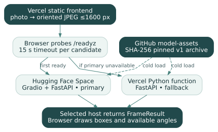

# Deployed architecture

A browser sends a still image to one selected service. The application code and the model bundle have independent release histories. Both hosts reported bundle hosted-onnx-demo during review.

| Component | Release identity and working behaviour |
| --- | --- |
| Browser | pack-station-psi.vercel.app • frontend/app.js and config.js. A saved custom API takes precedence. The initial readiness probe selects the host; a failed upload has no guaranteed automatic replay. |
| Primary / fallback | Space Git revision 465a53b0; primary package pin cf3992b. Fallback package pin 7453926. The Space uses Gradio’s server and mounts the REST routes. Both report ONNX CPU, GrabCut and colour-histogram matching. |
| Artifact path | Branch model-assets at b143625. Both adapters verify the expected archive digest before local extraction. This hosted hash check is distinct from the signed station-bundle installer. |
| Runtime observation | Both returned catalogue fixture-r1 and thresholds thr-dev-0.5. Their reported gallery vector hashes differ (HF 7b16c94878feebca; Vercel c17820435d2ba71b). Cross-host identity parity needs a common-image comparison. |

Sources: [Site](https://pack-station-psi.vercel.app), [Space](https://huggingface.co/spaces/Rohitpro1/pack-station-api/tree/465a53b02b56ad19a187164d9ebdb27d5c7f1e86), [Assets](https://github.com/Rohitpro1/product-vision-station/tree/b1436253c9387fd5408f355f1eb87383657f42e7), [HF meta](https://rohitpro1-pack-station-api.hf.space/v1/meta), [Vercel meta](https://pack-station-api.vercel.app/v1/meta), [Checks](https://github.com/Rohitpro1/product-vision-station/blob/b56c2a781939fc1524a5b9d2e1ba297992d58bfb/docs/VERIFICATION.md)
