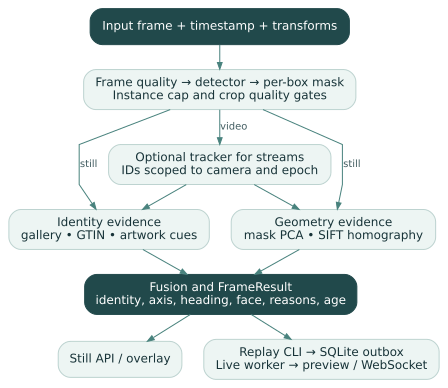

# Station processing and geometry

Still images, video replay and a local camera share Pipeline.process. A track exists only when a tracker is supplied. Public photo uploads are independent observations.

Axis is the dominant line through a mask, measured clockwise from image +x with +y downward, modulo 180°. An extent below 40 px or elongation below 1.6 can invalidate it. A/B direction is a separate 360° measurement. Matching reference artwork supplies the physical ends; SIFT/homography gates test ≥14 inliers, spread, reprojection error, mirror consistency and agreement with the axis.

A known, valid barcode uniquely associated with a crop can establish SKU. Strong contradictory evidence yields conflict. Visual SKU needs variant evidence; family ties, cross-family ambiguity and unknown have separate rules. Each result exposes its score type. Default gallery cosine scores are uncalibrated. OCR is unavailable.

The replay CLI enqueues durable transitions; the live API worker publishes frames and metrics. For tracked video, identity can be held for 1 s and directional evidence expires after 0.6 s under the development thresholds. Duplicate frames, gaps and reconnects affect evidence validity. A hidden end can leave an axis line and a null heading.

Sources: [Pipeline](https://github.com/Rohitpro1/product-vision-station/blob/b56c2a781939fc1524a5b9d2e1ba297992d58bfb/src/pvs/pipeline.py), [Fusion](https://github.com/Rohitpro1/product-vision-station/blob/b56c2a781939fc1524a5b9d2e1ba297992d58bfb/src/pvs/fusion.py), [API](https://github.com/Rohitpro1/product-vision-station/blob/b56c2a781939fc1524a5b9d2e1ba297992d58bfb/docs/API.md), [Ops](https://github.com/Rohitpro1/product-vision-station/blob/b56c2a781939fc1524a5b9d2e1ba297992d58bfb/docs/OPERATOR_GUIDE.md)
