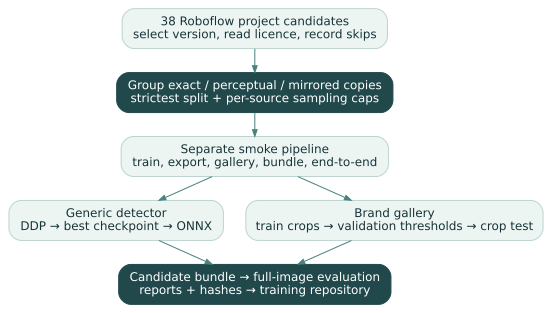

# Retail v2 training architecture

The public status snapshot showed 16,386 of 35,080 full-training steps (46.7%), epoch 10 of 20. The dataset write stage had a recorded workload of 65,034 image records across splits.

The runner processes the stages sequentially; the figure shows artifact dependencies. Both branches reuse the grouped data. The 22-family vocabulary includes 5 Star, Dairy Milk, Munch, KitKat and Perk; unmapped classes contribute package boxes and negative examples. Membership in the vocabulary alone does not qualify a brand for release.

The full pipeline caps detector test evaluation at 2,000 photos, and end-to-end sampling at 300 branded and 200 other photos. A passing smoke run exercises the path on a smaller sample. The last completed full epoch in the snapshot was 9, with 0.814 recall and 0.766 precision on sampled validation images. No final test figures were published at that revision.

The training repo then listed README.md, status.json and .gitattributes. Reviewed preparation telemetry and the configured list cannot establish which specific versions or licences contributed images. Reconcile results/download_report.json against results/data_stats.json → projects_used and images_by_project when published. Per-project rows are provided in dataset_register.csv.

Sources: [Sources](https://github.com/Rohitpro1/product-vision-station/blob/b56c2a781939fc1524a5b9d2e1ba297992d58bfb/configs/retail_datasets.yaml), [Training code](https://github.com/Rohitpro1/product-vision-station/blob/b56c2a781939fc1524a5b9d2e1ba297992d58bfb/scripts/gpu_train_retail.sh), [Telemetry](https://huggingface.co/Rohitpro1/pack-station-training/blob/55b036781ed354634b5f6cc7b562149632b2a8dc/status.json), [Preparation](https://huggingface.co/Rohitpro1/pack-station-training/commit/62af0ae82eec53908c65c91e5e9cf7a9f10fef2a), [Hub](https://huggingface.co/Rohitpro1/pack-station-training/tree/55b036781ed354634b5f6cc7b562149632b2a8dc), [Kaggle](https://www.kaggle.com/code/rohitkumarp/notebooka22cc96417)
